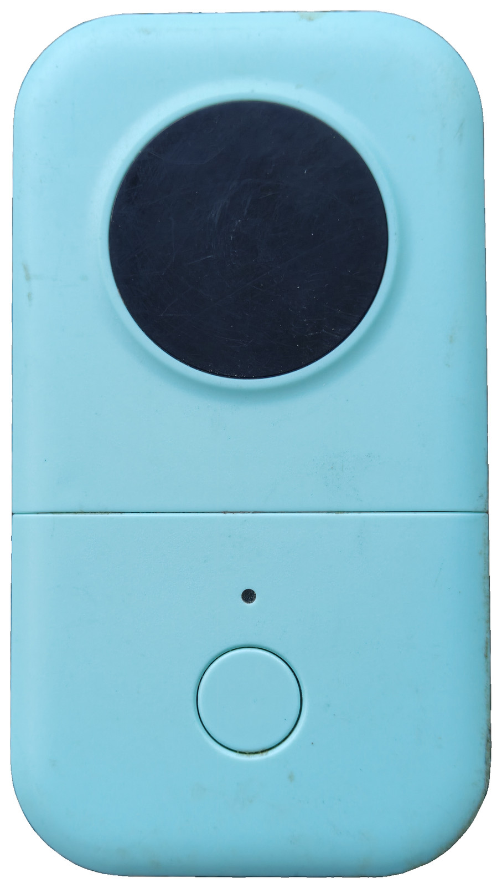
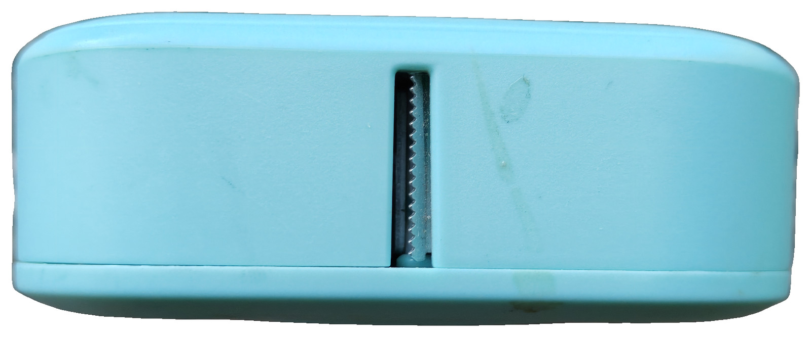
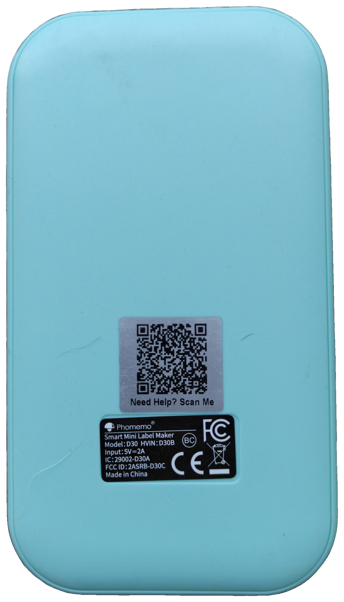
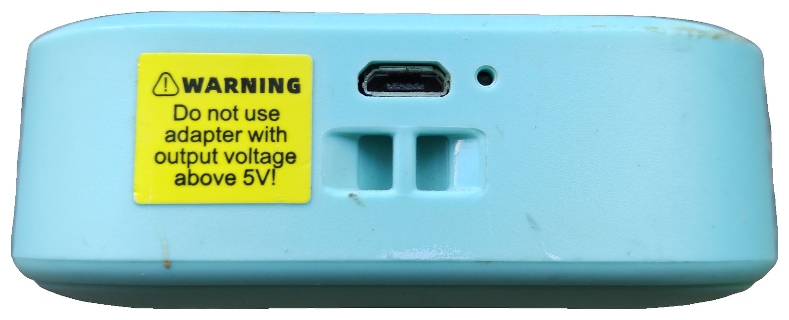
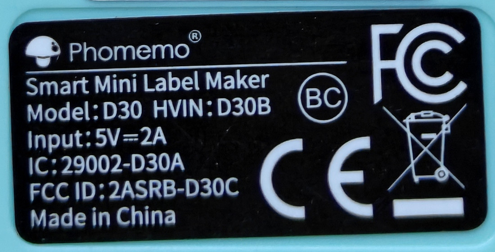

# Aimotech D30 (Bluetooth SPP)

12 mm 203 dpi thermal label printer. Official Android app is **Print
Master** (`com.project.aimotech.printmaster` 5.23.1, 小标打印). The
printer SDK is `com.project.aimotech.printer` (Quin / Labelife). Phomemo
D30 units use the same `D30Printer` class.

This recovered unit is Phomemo-branded (plate Model D30 / HVIN D30B).
Power button only; paper exits the slot on the short end opposite
USB-C. A yellow 5 V warning sticker sits next to the USB-C port.









Recovered from this XAPK (`PrintMaster_5.23.1_APKPure.xapk`). Helpers
print payloads. They do not scan, GATT-connect, or open RFCOMM. Frames
are **unproven on a live D30 this session**.

This APK's connect path is **classic SPP**, not GATT. Dual-mode BLE
GATT UUIDs were not in the decompiled printer package. Do not invent
`FFE0`. LAN IPP / phone web upload (PC holds the RFCOMM socket):
[label-bridge](../../label-bridge/).

## Identification

The rear rating plate is a crop of the real sticker (not redrawn), so
the IDs below match the hardware. The silver "Need Help? Scan Me" QR
above the plate is omitted from `label.jpg` (unit-unique query string).



| Field | Value |
|-------|--------|
| Brand on plate | Phomemo |
| Name on plate | Smart Mini Label Maker |
| Model | D30 |
| HVIN | D30B |
| Input | 5V=2A |
| FCC ID (printed) | [`2ASRB-D30C`](https://fccid.io/2ASRB-D30C) |
| IC | 29002-D30A |
| FCC grantee | Zhuhai Quin Technology Co., Ltd. (FRN 0028328375) |
| FCC equipment model | D30C (grant 2024-07-08, DSS + DTS 2402–2480 MHz) |
| Marks on plate | FC, BC, CE, WEEE |
| USB-C | charging; two unused rectangular slots beside the port |
| Feed control | power button only (round pad on the lid is the paper window) |
| Maker (app / SDK) | Aimotech (Quin / Phomemo family) |
| App | Print Master `com.project.aimotech.printmaster` |
| Class | `D30Printer` extends `QuinPrinter` |
| Printhead | 96 dots / 12 mm (`D30Printer.N = 12`) |
| Catalog | DefaultPrinter.json series D30 (largest group) |
| QR host (rear sticker) | `ms.phomemo.com` with model D30 |

TSPL ASCII (`CXTspl` / `B246DPrinter` / `M128Printer`) is a different
family in the same APK. This folder is the D30 `GS v 0` path. Do not
send NIIMBOT `55 55` XOR or Nelko `SIZE`/`GAP` TSPL here.

## Bluetooth

`BluetoothKit.m` always constructs `BluetoothSPP`. Discovery is classic
`startDiscovery` / `ACTION_FOUND`.

| | UUID | Role |
|--|------|------|
| RFCOMM SPP | `00001101-0000-1000-8000-00805f9b34fb` | default socket |
| Insecure RFCOMM | `fa87c0d0-afac-11de-8a39-0800200c9a66` | only when `BluetoothService.f49933f` is true |

Writes go `QueueBluetooth` → `BluetoothKit.B` → `BluetoothSPP.k`.

## Frames

After connect (`PrinterKit`):

```
1F 11 38
1F 11 12
1F 11 13
1F 11 07
```

Print (`D30Printer.q1`, `PrinterInfo.f48163n` path):

```
ESC @                         1B 40
GS v 0 m=0 + img2Nv           1D 76 30 00 | xL xH yL yH | raster
ESC d 23                      1B 64 17
```

`img2Nv(bitmap, 128, true)` prefixes little-endian width-bytes and
height, then 1bpp packed **bottom-right to top-left**. Dark is red
channel `< 128`. Multi-copy `r1` uses `1F 11 21` plus a copies byte
when `f49845p != 0`.

`InsSet.Y` is `{29, 118, 48, 0}`. `DtsUtil.f18847w` in `ESC d` is
**100** (`0x64`).

## Helper

```
./encode_aimotech.py self-test
./encode_aimotech.py handshake
./encode_aimotech.py print-seq --width-bytes 12 --height 1
./encode_aimotech.py decode 1d7630000c000100000000000000000000000000
```

CUPS: [cups/](cups/) (`printer-driver-aimotech`, URI
`aimotech://AA-BB-CC-DD-EE-FF`, `drv:///aimotech.drv/aimotechd30.ppd`).
Dash-separated MAC hosts; CUPS rejects colon octets as a port.
Package install is root once; queue add is the `lpadmin` group
(`aimotech-setup-printer --mac …` works while the printer is off);
`lp`/`lpr` needs no root. KDE System Settings → Printers lists the
configured dest (Description title) even when the D30 is off. Do not
commit the built `.deb`.
