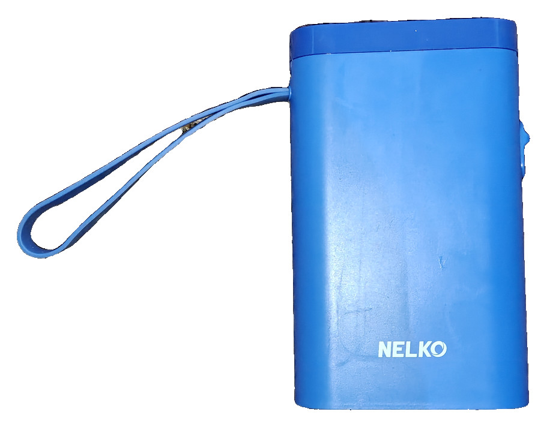
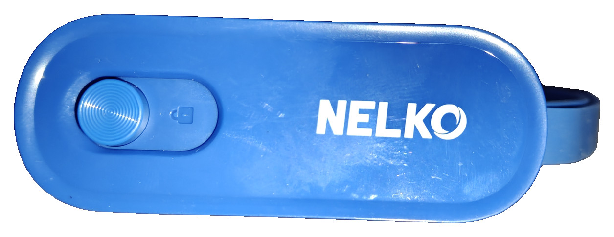
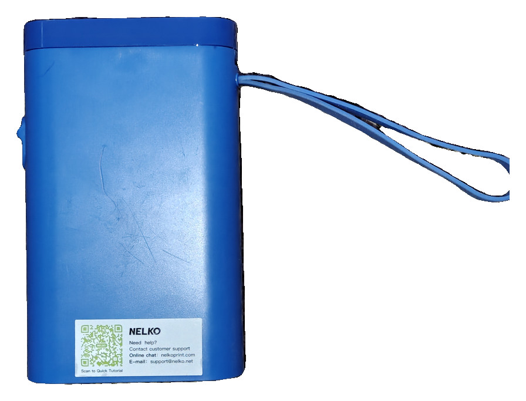
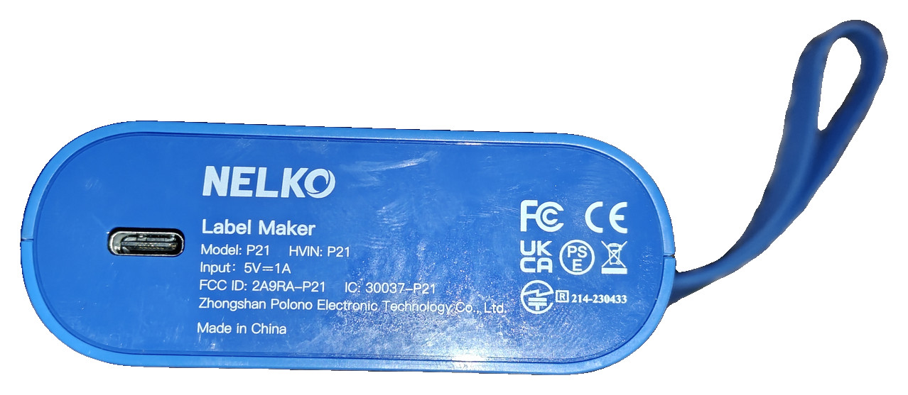
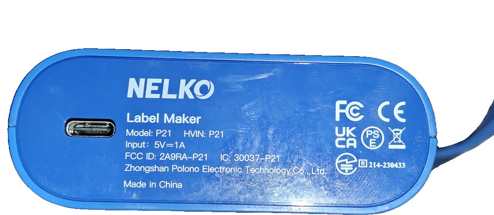
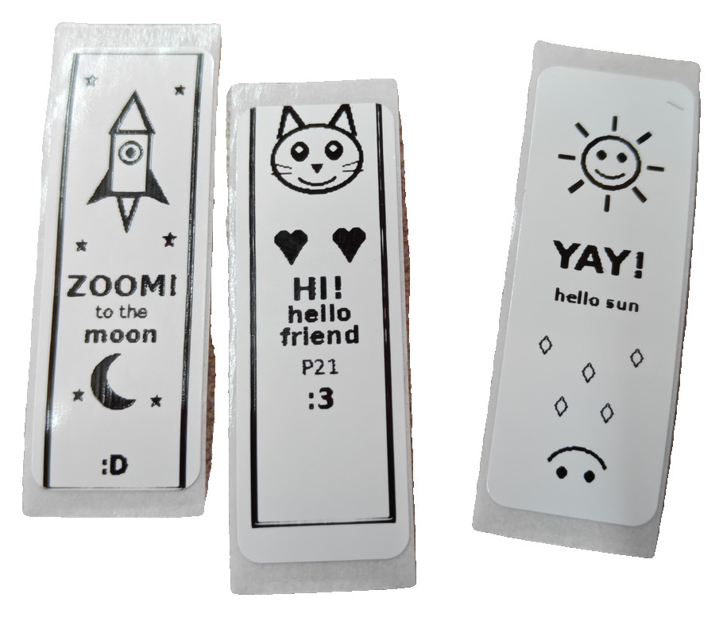

# Nelko P21

Pocket thermal label printer, 203 dpi, 12 mm / 96-dot printhead. Official
Android app is **Nelko** (`com.nelko.printer` 4.10.1). Cloud catalog
`command` **0** is TSPL. Labelnize and Polono rebrands share the same
JSON (`isEncrypt` 1 is RFID paper, not TSPL payload encryption).

**Live path (eject confirmed 2026-10-25):** classic SPP **RFCOMM
channel 1**, unpaired. Query `CONFIG?` / `BATTERY?` / `ESC ! ?` /
`ESC ! o`, then TSPL2 with leading CRLF, `SIZE 14 mm,40 mm`,
`DIRECTION 1,1`, `DENSITY 15`, `BITMAP` **mode 1**, **0 bit = black**.
This unit has no separate feed button (power button only).









Helpers print payloads. They do not scan, GATT-connect, or open
RFCOMM. CUPS backend/filter/PPD: [cups/](cups/). Live `lp` through
`printer-driver-nelko` ejected 2026-10-25 (PNG → rastertonelko →
RFCOMM). LAN IPP / phone web upload: [label-bridge](../../label-bridge/).

APK RE (`LabelCommand` / `BluetoothHelper.convertPrintData2Bytes`) was
incomplete for a live eject (SIZE 12, DIRECTION 0,0, BITMAP mode 0,
set-bit black, GATT `ff03` as TSPL RX). Independent capture plus live
CONFIG/STATUS/NFC match the job above.

Do not send TSPL to other `0000ff00` advertisers (JBD packs). Match by
name **P21**.

## Identification

The bottom rating plate is a crop of the real sticker (not redrawn), so
the IDs below match the hardware.



| Field | Value |
|-------|--------|
| Brand on plate | NELKO |
| Name on plate | Label Maker |
| Model / HVIN | P21 |
| Input | 5V=1A |
| FCC ID (printed) | [`2A9RA-P21`](https://fccid.io/2A9RA-P21) |
| IC | 30037-P21 |
| Plate manufacturer | Zhongshan Polono Electronic Technology Co., Ltd. |
| FCC grantee | Zhuhai Nelko Technology Co., Ltd. (FRN 0033187196) |
| USB-C | charging / CDC `4c4a:4155` (answers `ERROR0` only) |
| EMAIL on QR sticker | `support` at `nelko.net` |
| Online chat on QR sticker | nelkoprint.com |
| Marks on plate | FC, CE, UKCA, PSE, WEEE, KC **214-230433** |
| Feed control | power button only (concentric rings + lock slider on top) |
| Maker (app / SDK) | Nelko (Ezink print SDK in the APK) |
| App | Nelko `com.nelko.printer` |
| Cloud model | P21, dpi 203, maxWidth 12 mm, command 0, rfidProtocol 1 |
| Default paper | 14×40 mm GAP, defaultGap 5 mm (NFC `ESC ! o` paper_code) |
| Transport | RFCOMM ch1 primary. Same TSPL bytes on GATT `ff02` |
| Same TSPL family | P31S, P22, P24, PL80E, PM220, PM220S |

The plate prints `FCC ID: 2A9RA-P21`. That grant is BLE 2402–2480 MHz
portable label maker P21, original equipment 2023-05-16 / 2023-12-11.

Do not send NIIMBOT `55 55` XOR or Aimotech `GS v 0` here.

## Test prints

Live jobs on 14×40 mm GAP 5 mm, 2026-10-25: rocket `ZOOM!`, cat `HI!`,
sun `YAY!`. The last of those went through CUPS queue `NelkoP21`
(`rastertonelko`). Original print pixels; background removed.



## Reach

JieLi AC6951C dual-mode. Advertising UUIDs `00001101` + `0000af30`,
flags `0x06`. Keep the unit **unpaired**. BlueZ `Device.Connect()` /
`pair` tries BR/EDR, returns `org.bluez.Error.BREDR.ProfileUnavailable`,
and tears down LE. Python `AF_BLUETOOTH` / `BTPROTO_RFCOMM` channel 1
needs no PIN.

USB CDC `4c4a:4155` answers `ERROR0` only.

### SPP (print)

| | |
|--|--|
| UUID | `00001101-0000-1000-8000-00805f9b34fb` |
| Channel | 1 |
| Socket | `socket(AF_BLUETOOTH, SOCK_STREAM, BTPROTO_RFCOMM)` |

### GATT (same bytes, ATT writes are not an eject)

P21-family pocket BLE. Default ATT MTU 23 → 20 B writes. Request MTU
512 if the stack allows it. Write type **WRITE_CMD** (no response).

| | UUID | Handle | Role |
|--|------|--------|------|
| Service | `0000ff00-0000-1000-8000-00805f9b34fb` | 0x0004–0x0013 | printer |
| Write | `0000ff02-0000-1000-8000-00805f9b34fb` | 0x0006 | TX TSPL |
| Notify | `0000ff01-0000-1000-8000-00805f9b34fb` | 0x0008 | answers (CONFIG/status) |
| Notify | `0000ff03-0000-1000-8000-00805f9b34fb` | 0x000d | credits `01 NN` / `02 LL LL` |

JieLi OTA `0000ae3a` / `0000ae00` — do not use for print.

## Queries (before PRINT)

```
CONFIG?\r\n
BATTERY?\r\n
ESC ! ?\r\n     status byte: 00 READY, 01 lid, 04 no paper, 20 busy, 80 hot
ESC ! o\r\n     16 B NFC tag + CRC16/MODBUS; paper_code 14×40 gapped
```

`CONFIG` payload includes DPI u16be (`0x00cb` = 203), 3 B HW, 3 B FW.

## TSPL2 job

GB18030 (ASCII for this helper). Live job:

```
\r\n
SIZE 14 mm,40 mm
GAP 5 mm,0 mm
DIRECTION 1,1
DENSITY 15
CLS
BITMAP 0,0,12,320,1,<1bpp 0=black>
PRINT 1
```

`BITMAP` mode 0 overwrite, 1 OR, 2 XOR. Live eject used mode **1**.
Payload is 1bpp MSB-first, `widthBytes * height` bytes, then CRLF.
Printhead 96 dots → 12 bytes/row. 40 mm at 203 dpi → 320 rows.

`NativeLib.encryptV2` is a license write (`TestCommandActivity`), not
the print path.

## Helper

```
./encode_nelko.py self-test
./encode_nelko.py job --width-mm 14 --height-mm 40 --payload 80
./encode_nelko.py status
./encode_nelko.py nfc
```

CUPS: [cups/](cups/) (`printer-driver-nelko`, URI
`nelko://AA-BB-CC-DD-EE-FF`, `drv:///nelko.drv/nelkop21.ppd`). Package
install is root once; queue add is the `lpadmin` group; `lp`/`lpr`
needs no root. Dash-separated MAC hosts; CUPS rejects colon octets as
a port.
