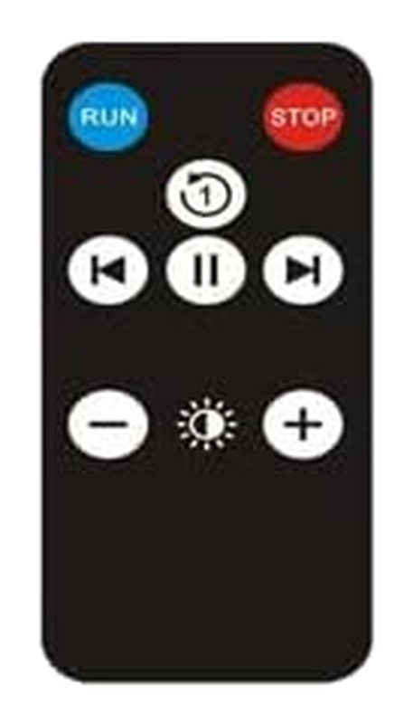

# 5D HOLO F1 (IR remote)

Wi-Fi Holofan HTTP sibling:
[Network/Displays/5D_HOLO/F1](../../../../Network/Displays/5D_HOLO/F1/).
Session, upload, play, geometry, and `encode_holofan.py` live there.

The kit clicker is **optical IR**. It is currently missing, so this
folder has **no Flipper `.ir`**. Do not invent command bytes. Learn it
on the Flipper when the remote turns up, then add `5D_HOLO_F1.ir`.

`remote.jpg` is canonical here. `unit-front.jpg` is a relative git
symlink to the Network card.

## Photo source

Placeholder cutouts from Amazon lookalike listing
[B08MWQQHCD](https://www.amazon.com/Hologram-Projector-Holographic-Advertising-Missyou/dp/B08MWQQHCD)
(Missyou 16.5 in / 42 cm hologram-fan kit) until own photos exist.
rembg BiRefNet-general onto white. Listing button artwork was not
redrawn.

This unit is **Holofan HTTP F1 116×520×6**, not the MissYou UDP 50xxx
stack. The listing graphic also claims 224 lamp beads. Replace these
JPEGs when a desk shot of the real fan and the found remote is
available.

Amazon originals stay in the unit folders as
`amazon-B08MWQQHCD-*.ignore.jpg` (gitignored).

## Identification

| | |
|--|--|
| Brand | 5D HOLO (ftlled) |
| Model | **F1** firmware **1.1.0** |
| Transport here | optical IR (clicker missing) |
| Wi-Fi sibling | [Network/Displays/5D_HOLO/F1](../../../../Network/Displays/5D_HOLO/F1/) |
| FCC ID | none on the listing photo |

## Visible buttons (listing photo)

Layout matches `remote.jpg`. Names are what is printed or drawn on the
clicker. No Flipper file and no address or command bytes yet.

| Remote | Notes |
|--------|-------|
| RUN | blue oval, top-left |
| STOP | red oval, top-right |
| 1 + clockwise arrow | loop / once icon |
| skip back | previous clip |
| pause | |
| skip forward | next clip |
| − | brightness down |
| sun | brightness |
| + | brightness up |

## Flipper file

None. Capture pending.

## Do not

- Invent NEC or raw frames
- Commit a `.ir` without a Flipper learn
- Format the TF/SD on the fan
