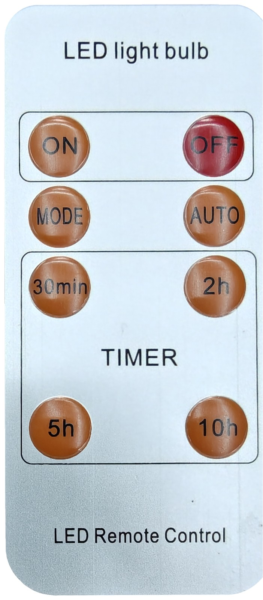
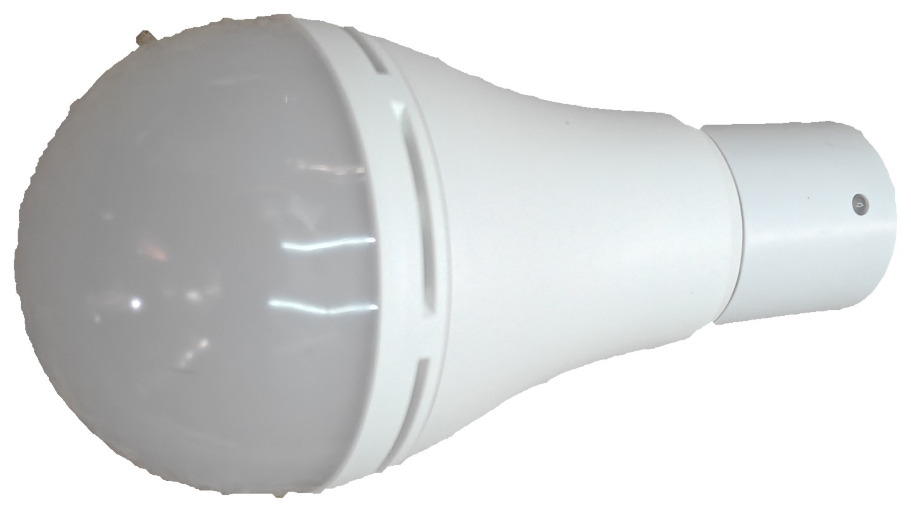
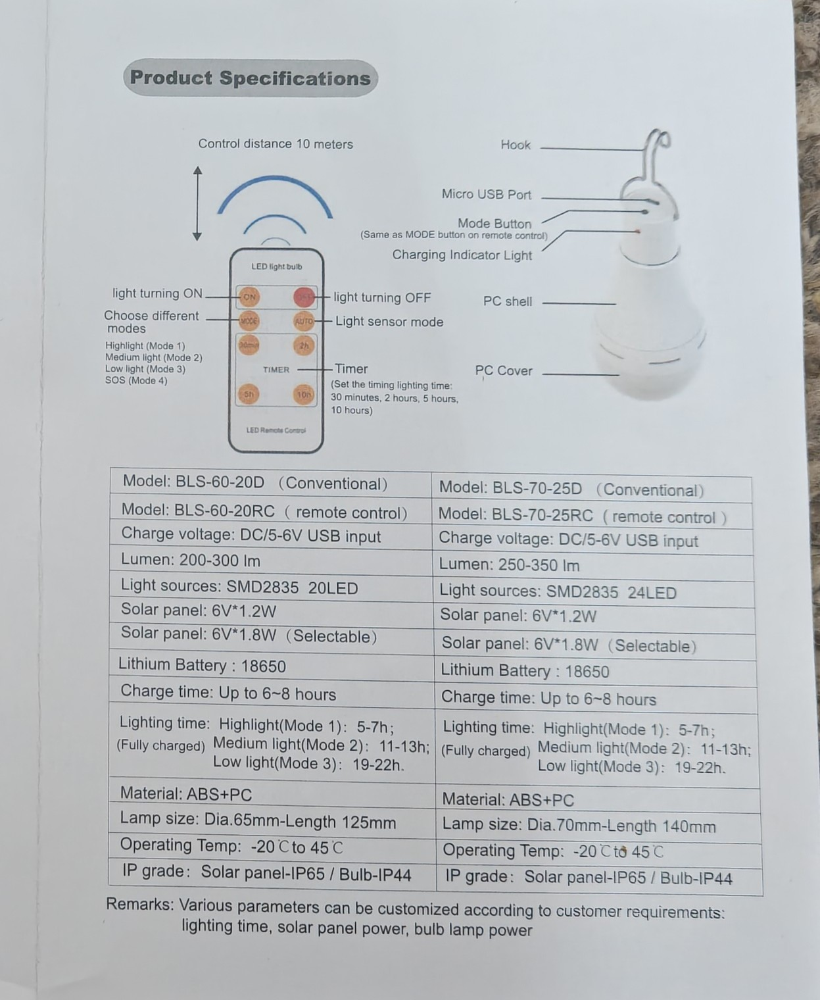
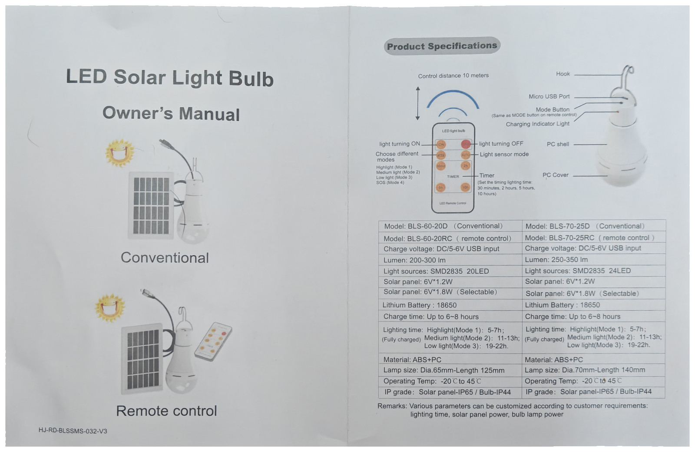
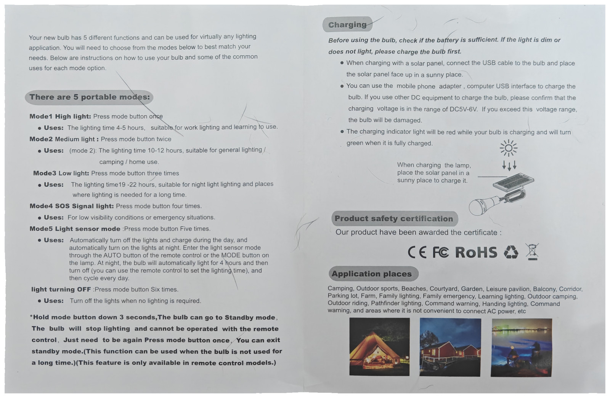

# BLS-70-25RC LED solar light bulb

[BLS](../) · [Lights](../../) · [Infrared](../../../)

Split-kit hanging LED bulb: a separate USB solar panel, an IP44 bulb with hook and micro-USB, and an 8-key IR remote. The included sheet titles it **LED Solar Light Bulb** and lists this unit as **BLS-70-25RC (remote control)**. No manufacturer name is printed on the hardware or the sheet.





## Identification

There is no rating plate or serial on the bulb, panel, or remote. IDs below are from the included Owner’s Manual spec table (`label.jpg` is a crop of that right-hand page, original pixels).



| Field | Value |
|-------|--------|
| Printed model | BLS-70-25RC (remote control) |
| Family on the same sheet | BLS-60-20D, BLS-60-20RC, BLS-70-25D |
| Brand on hardware | none |
| Type | LED solar light bulb (panel + hanging bulb) |
| Ingress | Solar panel IP65 / bulb IP44 |
| Marks on inner sheet | CE, FC, RoHS |
| FCC ID | none printed; no grant found for BLS-70-25RC |
| Serial | none printed |
| IR range (sheet) | 10 metres |
| Sheet code | HJ-RD-BLSSMS-032-V3 |
| Charge | DC 5–6 V USB; 18650; 6–8 h |
| Light | SMD2835 24 LED, 250–350 lm |

The remote is optical IR (NEC). The FC mark on the inner sheet is the generic logo, not an FCC grant ID. An FCC ID is not expected on this clicker.

## Included sheet

Owner's Manual / spec table, then modes / charging / marks. Original pixels, rembg cutout onto white.





## Flipper file

[`BLS_BLS-70-25RC.ir`](BLS_BLS-70-25RC.ir) — copy to the Flipper SD card under `infrared/`.

## Remote buttons

Layout matches the remote photo. Sheet names are from **Product Specifications** on the included leaflet.

| Remote | Sheet | Flipper name | Capture |
|--------|-------|--------------|---------|
| ON | Light turning ON | On | NEC `0x01` |
| OFF | Light turning OFF | Off | NEC `0x03` |
| MODE | Choose different modes (1–4 / SOS) | Mode | raw NEC **repeat only** |
| AUTO | Light sensor mode | Auto | raw NEC **repeat only** |
| 30min | Timer 30 minutes | 30m | raw NEC **repeat only** |
| 2h | Timer 2 hours | 2h | NEC `0x1F` |
| 5h | Timer 5 hours | 5h | raw NEC **repeat only** |
| 10h | Timer 10 hours | 10h | NEC `0x09` |

Parsed buttons use **NEC** with address **`0x80`**. In the `.ir` file that is:

```
protocol: NEC
address: 80 00 00 00
command: XX 00 00 00
```

Mode, Auto, 30m, and 5h were learned as NEC repeat bursts only (~9.1 ms mark, ~2.25 ms space, ~560 µs mark, ~96 ms gap). `correct_parsed_ir.py` classifies them as NEC repeats with no 32-bit payload (Mode also has a Flipper timeout mark before the first burst). They stay `type: raw`. No unique public map matched the four parsed siblings (On `0x01`, Off `0x03`, 2h `0x1F`, 10h `0x09`), so command bytes are not filled. Re-learn those four keys if you need parsed NEC.

## Notes

- On and Off are separate codes.
- MODE on the remote matches the mode button on the bulb neck (sheet: same as MODE).
- AUTO is the dusk/light-sensor mode (sheet Mode 5).
- 30min / 2h / 5h / 10h are on-timers.
- `unit-front.jpg` is a cutout of the bulb on carpet; the hook is omitted. Panel and hook-end shots were not cut to white.
- Hold-mode-button 3 s standby is a lamp-button gesture, not an IR code.
