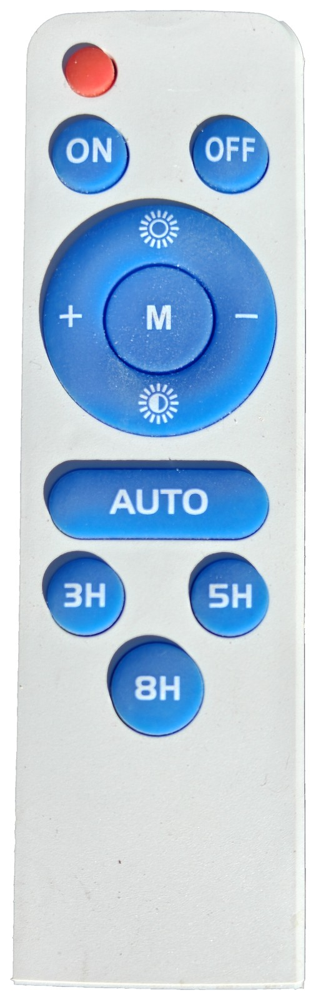
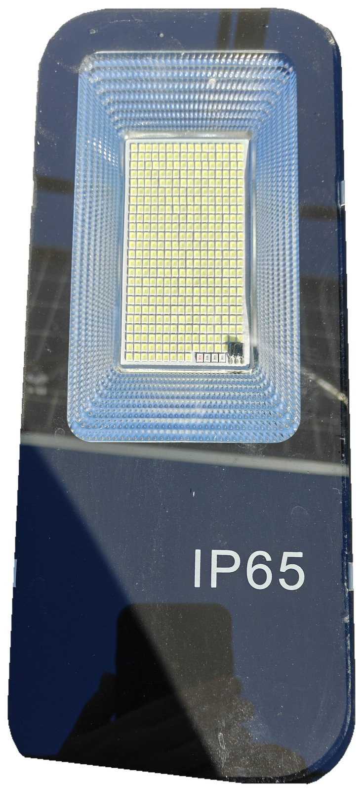
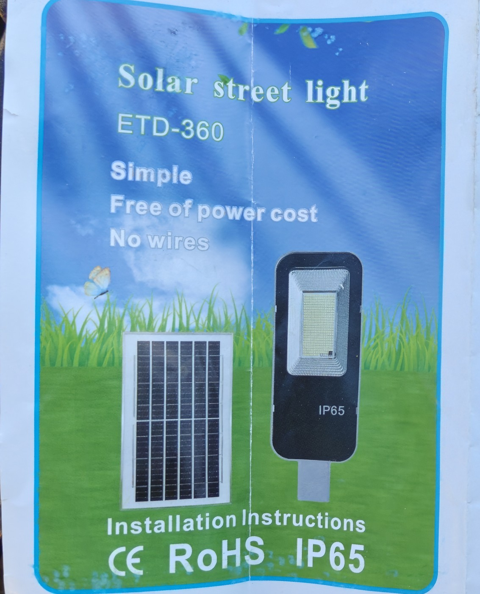
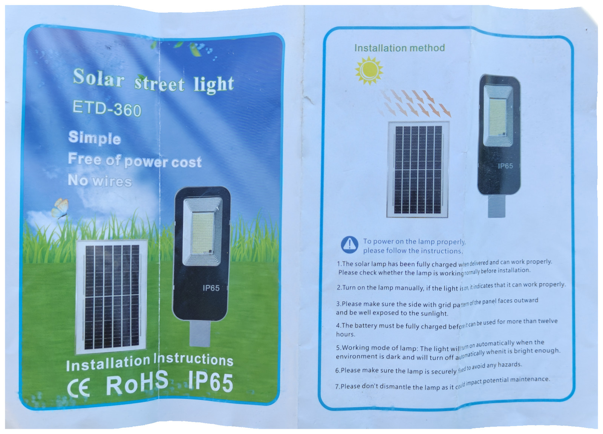
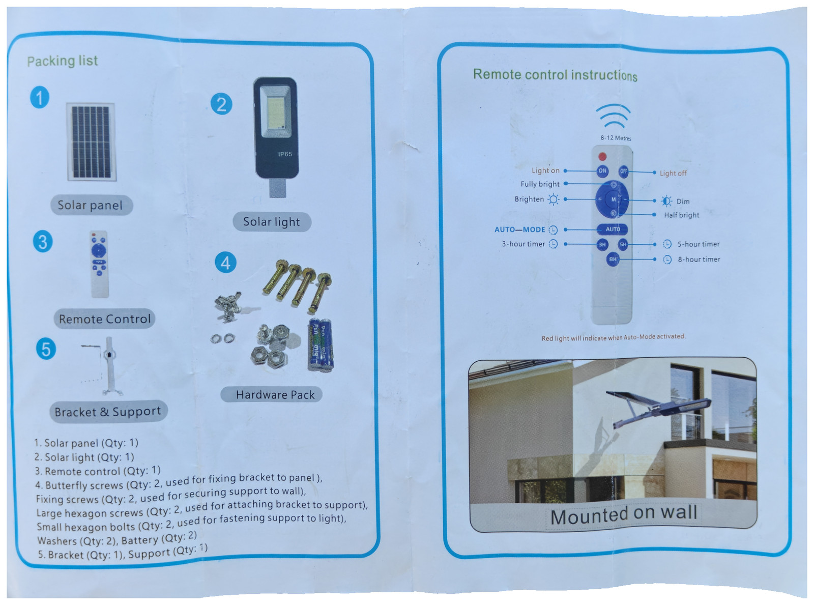

# ETD-360 solar street light

[ETD](../) · [Lights](../../) · [Infrared](../../../)

Split-kit outdoor LED lamp: a separate solar panel, an IP65 street-light head, a wall bracket, and a 12-key IR remote. The included sheet titles it **Solar street light ETD-360**. No manufacturer name is printed on the hardware or the sheet.





## Identification

There is no rating plate or serial on the lamp, panel, or remote. IDs below are from the included instruction cover (`label.jpg` is a crop of that sheet, original pixels) plus the **IP65** legend printed on the lamp face.



| Field | Value |
|-------|--------|
| Printed model | ETD-360 |
| Brand on hardware | none |
| Type | Split solar street light (panel + lamp + bracket) |
| Ingress | IP65 (on the lamp face and on the sheet) |
| Marks on sheet | CE, RoHS, IP65 |
| FCC ID | none printed; no grant found for ETD-360 |
| Serial | none printed |
| IR range (sheet) | 8–12 metres |

The remote is optical IR (NEC). An FCC ID is not expected on this clicker.

## Included sheet

Cover / installation spread, then packing list / remote map. Original pixels, rembg cutout onto white.





## Flipper file

[`ETD_ETD-360.ir`](ETD_ETD-360.ir) — copy to the Flipper SD card under `infrared/`.

## Remote buttons

Layout matches the remote photo, top to bottom. Sheet names are from **Remote control instructions** on the included leaflet.

| Remote | Sheet | Flipper name | NEC command |
|--------|-------|--------------|-------------|
| Top red key | (unlabeled; sheet notes a red Auto-Mode light and 8–12 m range at the top) | Red | `0x45` |
| ON | Light on | On | `0x46` |
| OFF | Light off | Off | `0x44` |
| Top sun | Fully bright | Brighter | `0x43` |
| Bottom sun | Half bright | Dimmer | `0x0D` |
| + | Brighten | + | `0x07` |
| − | Dim | - | `0x09` |
| M (center of the cluster) | unlabeled | M | `0x08` |
| AUTO | AUTO MODE | Auto | `0x19` |
| 3H | 3-hour timer | 3H | `0x15` |
| 5H | 5-hour timer | 5H | `0x16` |
| 8H | 8-hour timer | 8H | `0x18` |

All buttons use **NEC** with address **`0x00`**. In the `.ir` file that is:

```
protocol: NEC
address: 00 00 00 00
command: XX 00 00 00
```

Same address and commands will work from any NEC blaster (Flipper, ESPHome `remote_transmitter`, Arduino IRremote). There is no checksum beyond standard NEC inversion of the command byte, which the Flipper firmware adds when it sends a parsed NEC signal.

## Notes

- On and Off are separate codes.
- Top sun is a full-bright preset; bottom sun is a half-bright preset; + / − step brightness.
- AUTO is the dusk-to-dawn mode. The sheet says a red light indicates when Auto-Mode is on.
- 3H / 5H / 8H are on-timers.
- `unit-front.jpg` is a cutout of the lamp face. The mounting tenon at the bottom of the head is omitted from that cutout.
- Rear of the head is finned aluminum with two screws on the tenon; a clean white-background rear was not cut from the table shot.
