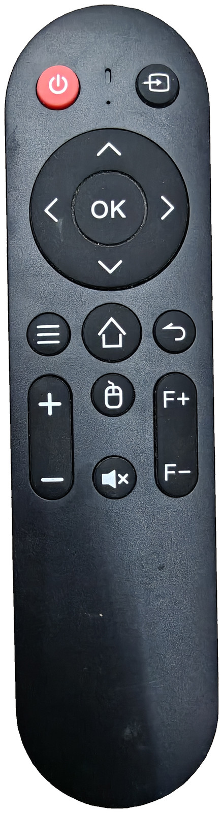
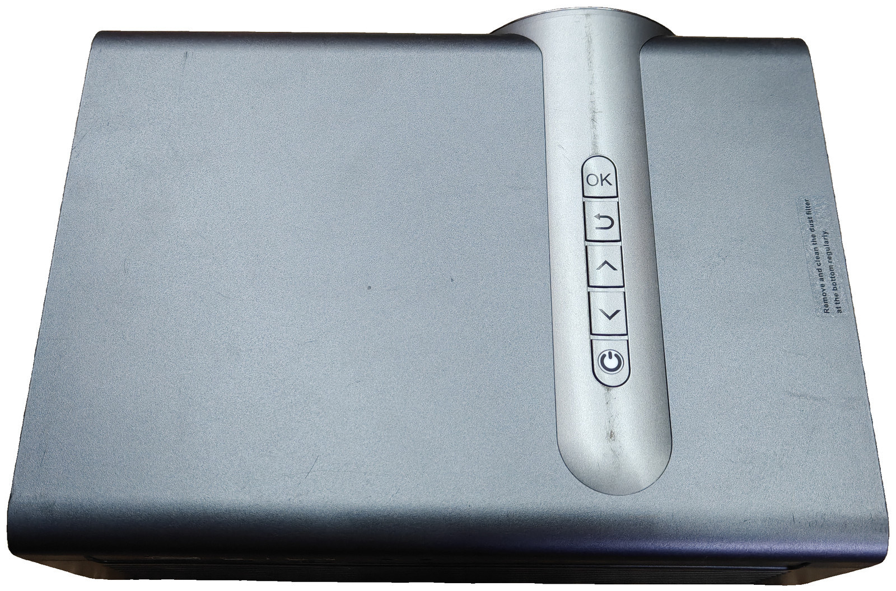
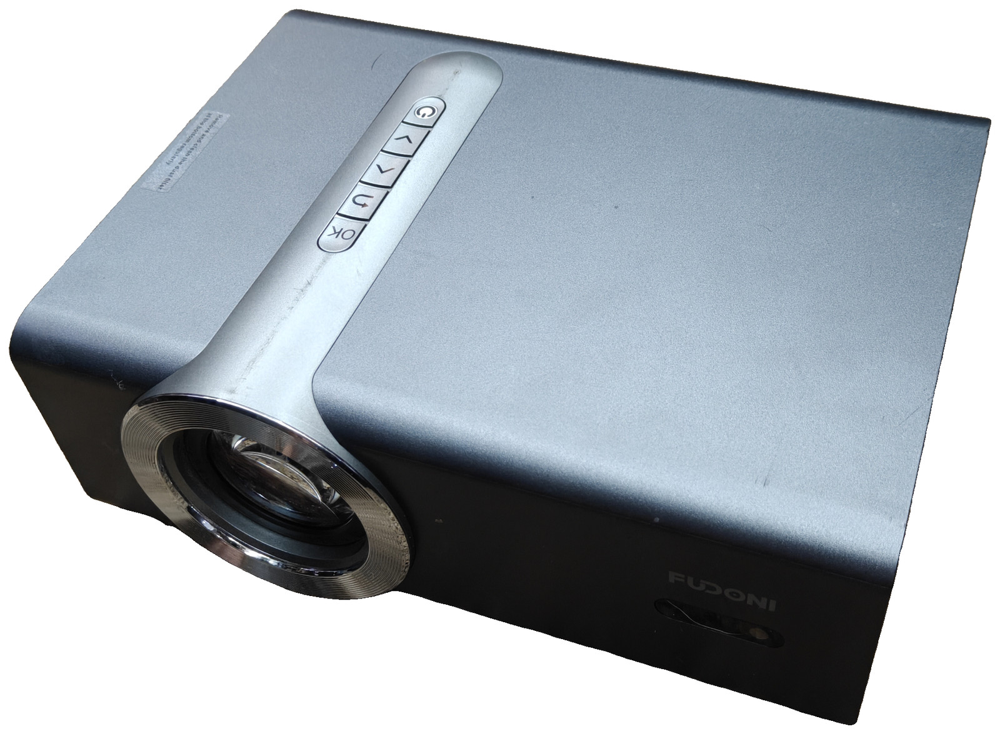
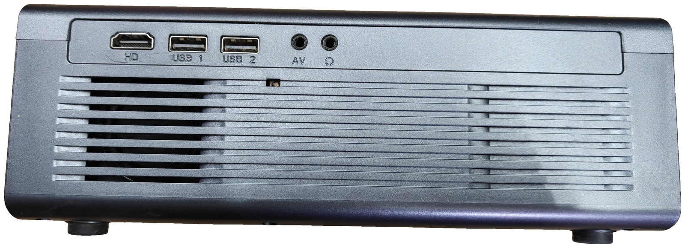
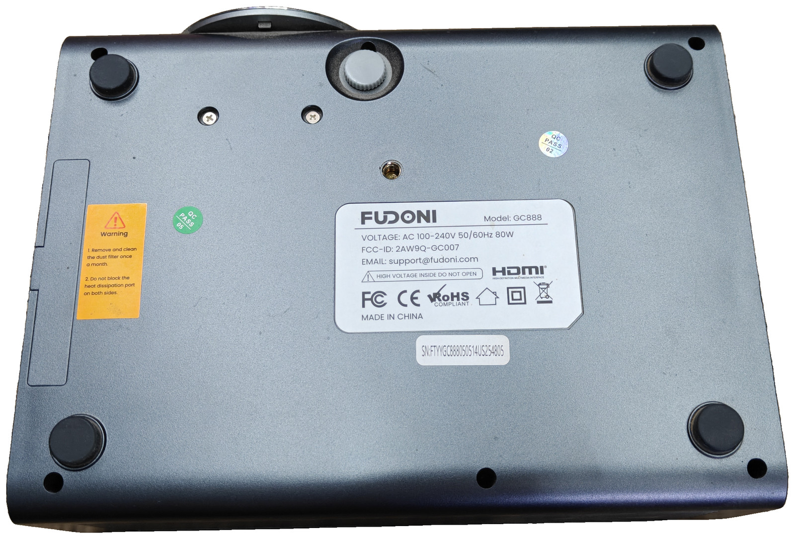
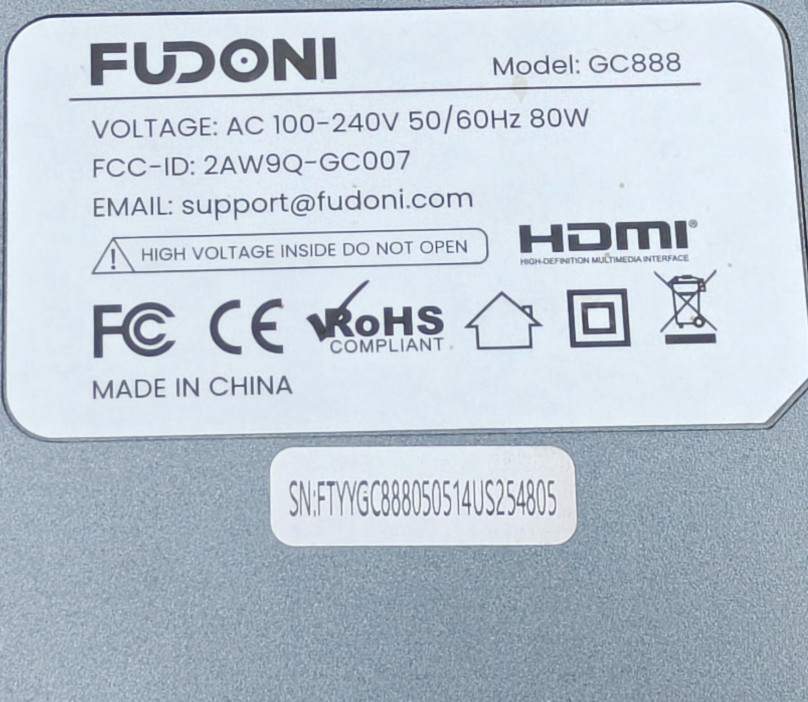

# FUDONI GC888 projector

[Fudoni](../) · [Projectors](../../) · [Infrared](../../../)

Portable LCD projector (grey top, black mid-band, silver lens ring). The
bundled IR remote is a NECext clicker: power, input, navigation, volume,
mouse, mute, and focus. Focus +/− are also on the remote (`F+` / `F−`).
On-unit keys on the top strip, lens toward the rear: OK, Back, Up, Down,
Power.











## Identification

The bottom rating plate and serial pill are crops of the real stickers (not
redrawn), so the IDs below match the hardware.



| Field | Value |
|-------|--------|
| Brand on plate | FUDONI |
| Model | GC888 |
| Voltage | AC 100–240 V 50/60 Hz 80 W |
| FCC ID (printed) | [`2AW9Q-GC007`](https://fccid.io/2AW9Q-GC007) |
| Grantee | Golden Coast Technology (shenzhen) Co.,Ltd |
| FCC equipment model | GC007 (model-difference filing vs retail GC888) |
| EMAIL on plate | `support` at `fudoni.com` |
| Serial | `FTYYGC888050514US254805` |
| Marks on plate | FC, CE, RoHS COMPLIANT, indoor-use, Class II, WEEE, HDMI, HIGH VOLTAGE INSIDE DO NOT OPEN, MADE IN CHINA |
| QC stamps | QC PASS 05 (green) and QC PASS 02 (holographic oval) on the hardware; omitted from `label.jpg` |

The plate prints `FCC-ID: 2AW9Q-GC007`. That grant is the FCC listing for the
GC007 projector family (2.4 GHz and 5 GHz) from Golden Coast Technology.

Rear ports, left to right: HDMI (`HD`), USB 1, USB 2, AV, headphone. Exhaust
grille is below the port strip. IEC power inlet is on the adjacent short side
under the FUDONI wordmark. Dust-filter reminder is printed on the top:
remove and clean the filter at the bottom regularly.

## Flipper file

[`Fudoni_GC888.ir`](Fudoni_GC888.ir) — copy to the Flipper SD card under `infrared/`.

## Remote buttons

Layout matches the remote photo, top to bottom:

| Remote | Flipper name | NECext command |
|--------|--------------|----------------|
| Red power | Power | `87 78` |
| Arrow into a square | Input | `DC 23` |
| D-pad / OK | Up Down Left Right Ok | `84 7B` `8D 72` `BB 44` `8E 71` `B2 4D` |
| Hamburger | Menu | `8A 75` |
| House | Home | `4F B0` |
| Bent arrow | Back | `8B 74` |
| + / − | Vol+ Vol- | `89 76` `B5 4A` |
| Mouse | Mouse | `41 BE` |
| Speaker × | Mute | `5B A4` |
| F+ / F− | Focus+ Focus- | `45 BA` `F5 0A` |

All buttons use **NECext** with address **`0x1608`**. In the `.ir` file that is:

```
protocol: NECext
address: 08 16 00 00
command: XX YY 00 00
```

Same address and commands will work from any NECext blaster (Flipper, ESPHome
`remote_transmitter`). There is no checksum beyond standard NEC inversion of
each byte, which the Flipper firmware adds when it sends a parsed NECext
signal.

## Notes

- Power is a toggle. There is no separate on and off code.
- Input cycles the on-screen source list (HDMI / USB / AV).
- F+ / F− are remote focus. There is no keystone key on this clicker.
- `unit-bottom.jpg` keeps the original QC ovals. `label.jpg` is the plate plus
  the serial pill only.
